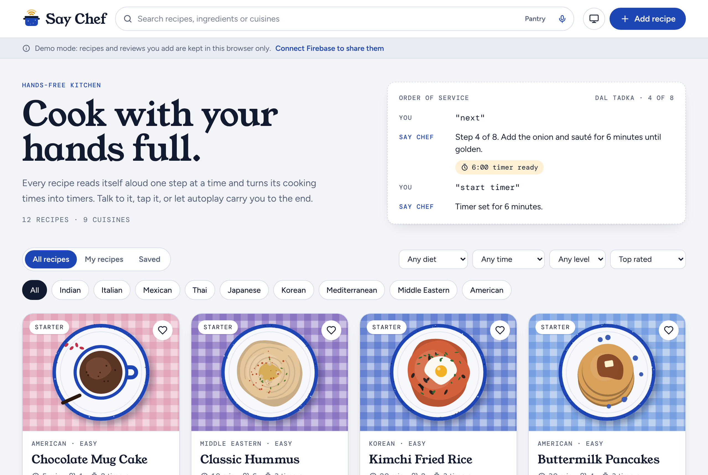
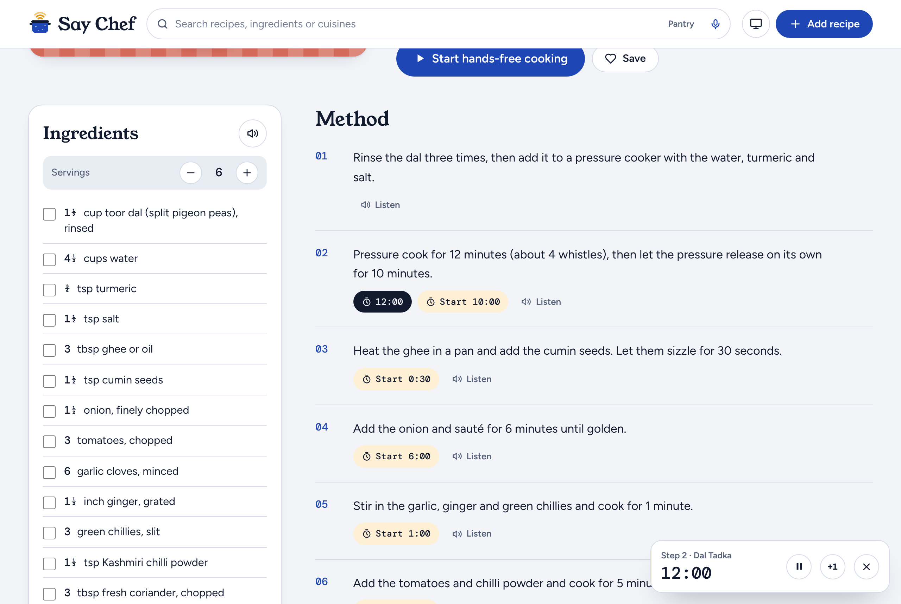
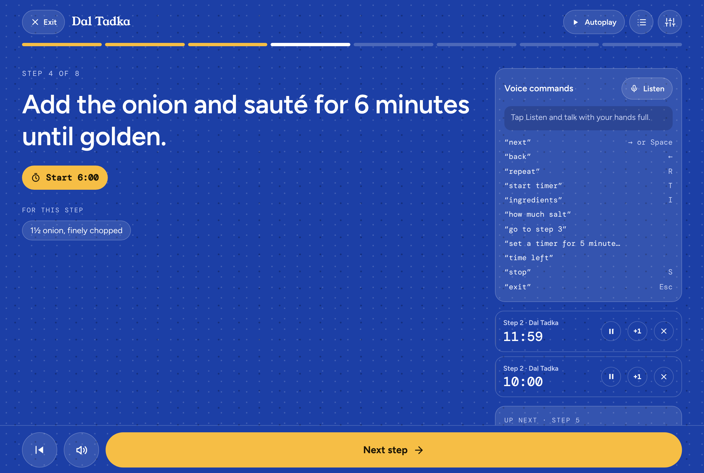
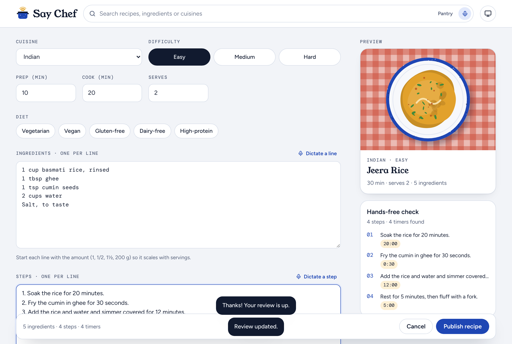
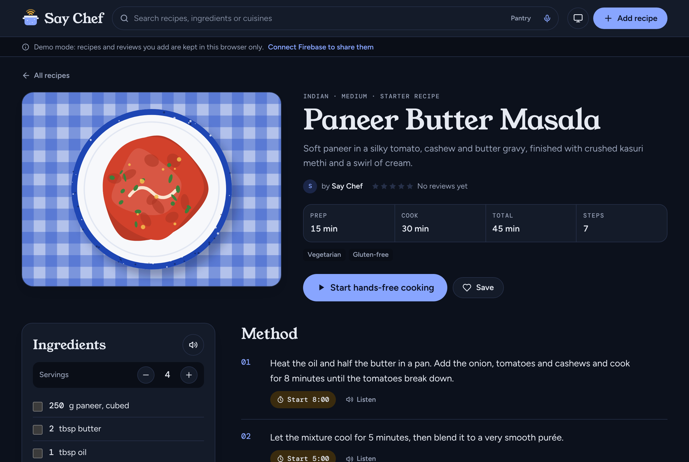
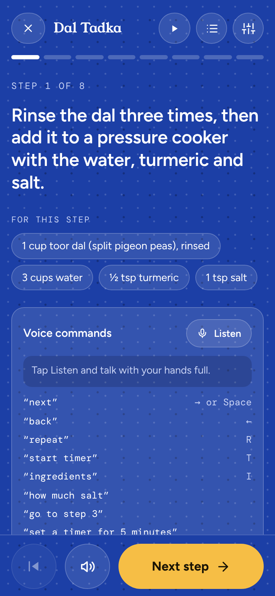

<div align="center">


# Say Chef

**Share recipes, then cook them hands-free.** Say Chef reads each step aloud, listens for voice commands like *"next"* and *"how much salt?"*, and turns every cooking time it finds into a one-tap timer.

[](https://github.com/AYUshJaiswal454/say-chef/actions/workflows/ci.yml)
[](https://github.com/AYUshJaiswal454/say-chef/actions/workflows/deploy.yml)
[](LICENSE)
[](CONTRIBUTING.md)

[**Live demo**](https://say-chef.onrender.com) · [Set up Firebase](docs/FIREBASE_SETUP.md) · [Voice commands](docs/VOICE_COMMANDS.md) · [Contribute](CONTRIBUTING.md)



</div>

## Why

Recipes are written for reading, but cooking happens with flour on your hands. Say Chef is a recipe app built for the moment you're standing at the stove: big type you can read from across the kitchen, a voice that reads the step for you, and timers that start themselves.

It's also a complete, well-tested example of a modern React app with real-time data, authentication, security rules and the Web Speech API, written to be easy to learn from and contribute to.

## Features

**Hands-free cooking mode**

- Reads each step aloud with natural phrasing ("1½ tbsp" becomes "1 and a half tablespoons")
- Listens for voice commands: *next, back, repeat, start timer, how much salt, go to step 3, set a timer for 5 minutes, time left, stop, exit*
- Finds every time in a step ("simmer for 10 minutes", "rest 1-2 hours", "half an hour") and offers a timer for each
- **Autoplay** reads a step, runs its timer, and moves on when the timer rings
- Shows which ingredients each step uses, scaled to your servings
- Keeps the screen awake, chimes and speaks when a timer ends, and flashes the tab title
- Every voice command also has a keyboard shortcut and a big tap target

**Recipes**

- Add, edit and delete your own recipes, with dictation for every field
- Live "hands-free check" while you write shows the timers it found
- Search by title, ingredient or cuisine, by voice or by typing
- **Pantry match**: type what you have ("rice, eggs, spring onion") and get recipes ranked by how much you already own
- Filter by cuisine, diet, total time and difficulty; sort by rating, speed, date or reviews
- Scale servings and every amount updates, with kitchen fractions (⅓, ½, ¾)
- Save favourites, synced to your account
- A unique generated plate illustration for every recipe, so there are no broken image links

**Community**

- Google sign-in through Firebase Auth
- Star ratings and written reviews, one per cook per recipe, with a rating breakdown
- Recipes and reviews update live for everyone, and work offline with Firestore's local cache
- Server-side security rules: only authors can edit their recipes, and rating totals can't be faked

**Everywhere**

- Light and dark themes (follows your device, or pick one)
- Works at phone width, installable as a home-screen app
- **Demo mode** runs with no setup at all: recipes live in your browser until you connect Firebase

## Screenshots

| Recipe page | Cooking mode |
| --- | --- |
|  |  |
| **Recipe editor** | **Dark mode** |
|  |  |

<p align="center"></p>

## Tech stack

| | |
| --- | --- |
| UI | [React 19](https://react.dev) + TypeScript, built with [Vite](https://vite.dev) |
| Styling | [Tailwind CSS v4](https://tailwindcss.com) with light/dark design tokens |
| Voice | [Web Speech API](https://developer.mozilla.org/docs/Web/API/Web_Speech_API): `SpeechRecognition` for commands, `speechSynthesis` for reading aloud |
| Data | [Firebase](https://firebase.google.com): Authentication (Google) and Cloud Firestore with offline persistence |
| Tests | [Vitest](https://vitest.dev) unit tests and Firestore emulator tests for the security rules |
| CI/CD | GitHub Actions: typecheck, lint, test and build on every PR; deploy to GitHub Pages from `main` |

No UI kit, router or state library: the whole app is small enough that plain React and a router of under 100 lines read more clearly.

## Quick start

You need [Node.js 20.19+](https://nodejs.org).

```bash
git clone https://github.com/AYUshJaiswal454/say-chef.git
cd say-chef
npm install
npm run dev
```

Open http://localhost:5173. With no Firebase settings, Say Chef starts in **demo mode** with 12 starter recipes stored in your browser, so you can try everything right away.

> **Voice recognition** works in Chrome, Edge and Safari, and needs a secure page (`https://` or `localhost`). Firefox can read steps aloud but can't listen yet; every command still works by keyboard and touch.

## Share recipes with Firebase

1. Create a Firebase project, add a web app, and turn on **Google** sign-in and **Cloud Firestore**.
2. Copy `.env.example` to `.env.local` and paste in your web app's config.
3. Deploy the security rules: `npx firebase-tools deploy --only firestore`.
4. Restart `npm run dev`, sign in, and click **Add 12 starter recipes**.

The full walkthrough, including authorised domains and hosting, is in [docs/FIREBASE_SETUP.md](docs/FIREBASE_SETUP.md).

## Scripts

| Command | What it does |
| --- | --- |
| `npm run dev` | Start the dev server with hot reload |
| `npm run build` | Typecheck and build for production into `dist/` |
| `npm run preview` | Serve the production build locally |
| `npm test` | Run the unit tests once (`npm run test:watch` to keep watching) |
| `npm run lint` | Lint with ESLint |
| `npm run typecheck` | Check types without building |
| `npm run check` | Typecheck, lint and test, the same as CI |
| `cd tests/rules && npm install && npm test` | Test `firestore.rules` against the Firestore emulator (needs Java 21) |

## Project structure

```
src/
├── App.tsx                 Routes, banners and footer
├── main.tsx                Entry point
├── index.css               Tailwind + design tokens (light and dark)
├── components/             Header, RecipeCard, Timers, Stars, DictateButton, PlateArt…
├── pages/                  BrowsePage, RecipePage (+ reviews), EditRecipePage, CookPage
├── state/                  App data and auth, kitchen timers, voice prefs, toasts
├── hooks/                  Microphone, voices, speaking state, screen wake lock
├── data/                   Cuisines, diets and the starter recipes
└── lib/
    ├── data/               DataSource interface, Firestore and local (demo) implementations
    ├── recipe/             Duration parsing, quantity scaling, ingredient matching, speech text, validation
    ├── voice/              Speech synthesis, speech recognition, voice command grammar
    ├── plateArt.ts         Generated SVG plate illustrations
    └── router.tsx          A tiny History API router
firestore.rules             Who can read and write what
tests/rules/                Emulator tests for the security rules
docs/                       Setup guide, architecture, voice commands, roadmap
```

Read [docs/ARCHITECTURE.md](docs/ARCHITECTURE.md) for how the pieces fit together.

## Deploy

**GitHub Pages** (already set up): every push to `main` builds and deploys through [`.github/workflows/deploy.yml`](.github/workflows/deploy.yml). To deploy with Firebase, add your config as repository variables named like the keys in `.env.example` (Settings → Secrets and variables → Actions → Variables). Without them the site runs in demo mode.

**Render** (free static site): click the button below, or in the Render dashboard choose **New → Blueprint** and pick your fork. [`render.yaml`](render.yaml) sets the build, the publish folder and the rewrite that makes deep links work. To use Firebase, add the `VITE_FIREBASE_*` variables under the service's **Environment** tab and redeploy.

[](https://render.com/deploy?repo=https://github.com/AYUshJaiswal454/say-chef)

**Firebase Hosting**: `npm run build && npx firebase-tools deploy`. `firebase.json` already rewrites every path to `index.html`.

Any static host works, as long as unknown paths serve `index.html`.

## Contributing

Contributions of every size are welcome, from a new cuisine to a smart-speaker integration. Good places to start:

- **Add a cuisine**: one line in [`src/data/cuisines.ts`](src/data/cuisines.ts)
- **Add a starter recipe**: [`src/data/starterRecipes.ts`](src/data/starterRecipes.ts)
- **Teach the voice parser a new phrase**: [`src/lib/voice/commands.ts`](src/lib/voice/commands.ts), with a test
- Bigger ideas, such as personalised recommendations, photo uploads, shopping lists and Google Home or Alexa integration, are in the [roadmap](docs/ROADMAP.md)

See [CONTRIBUTING.md](CONTRIBUTING.md) for setup, conventions and how to open a pull request. Please follow the [Code of Conduct](CODE_OF_CONDUCT.md).

## Privacy

Speech synthesis runs in your browser. Speech recognition is handled by your browser's speech service: Chrome and Edge send audio to their cloud service while listening, and Safari may process it on your device. Say Chef only listens while the microphone button is on, and never records or stores audio.

## License

[MIT](LICENSE). Fonts are [Young Serif](https://fonts.google.com/specimen/Young+Serif), [Figtree](https://fonts.google.com/specimen/Figtree) and [DM Mono](https://fonts.google.com/specimen/DM+Mono), all under the SIL Open Font License.
